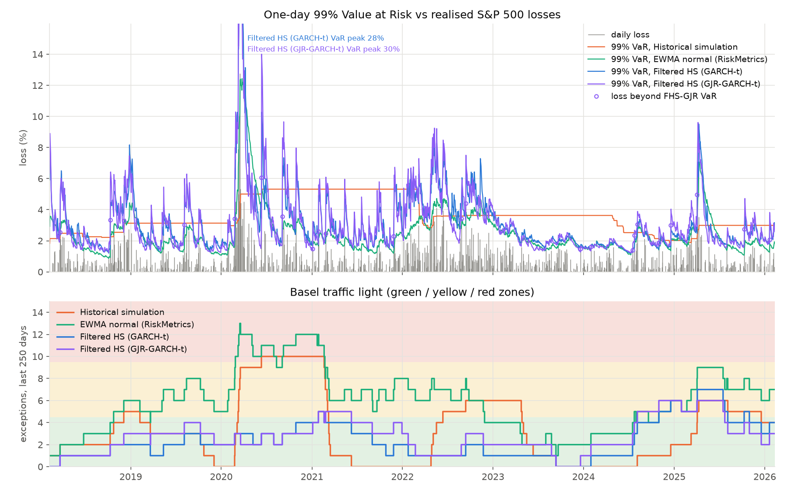
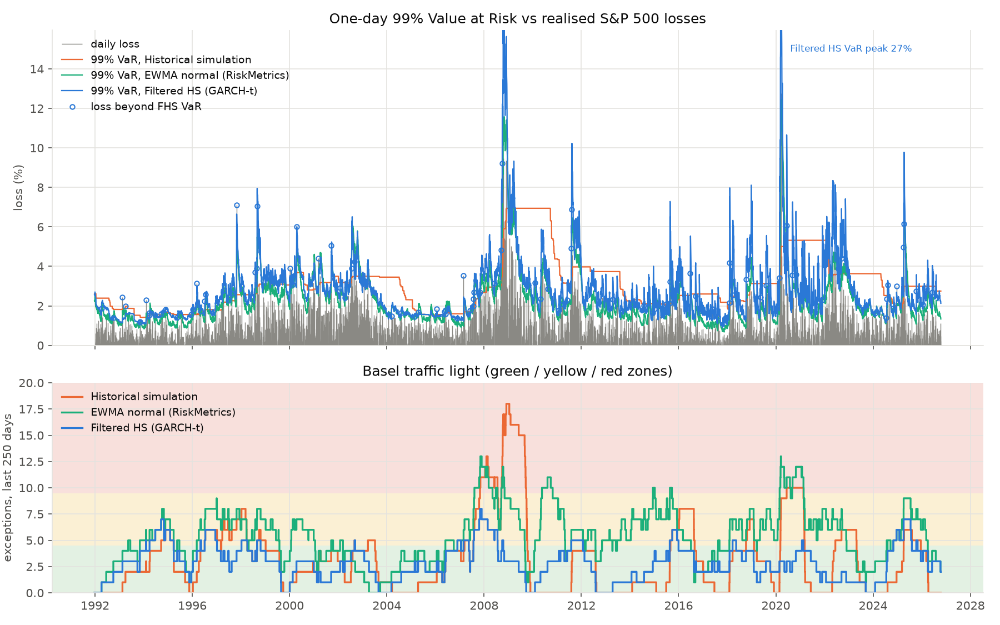

# VaR Backtest

**Which risk model would have survived 2020?** Three standard ways (plus one variant) to compute the one-day Value at Risk and Expected Shortfall of an S&P 500 position, run day by day over 2018–2026 using only data available at the time, then judged by the same backtests regulators use.



| Model | 99% VaR exceptions (expected 20.1) | Kupiec p | Christoffersen p | Worst 250 days (Basel) | ES Z2 p | Average VaR |
|---|---|---|---|---|---|---|
| Historical simulation | 27 | 0.144 | **0.004** | **10, red** (to 2020-06) | **0.000** | 3.59% |
| EWMA normal (RiskMetrics) | **50** | **0.000** | 0.504 | **13, red** (to 2020-03) | **0.000** | 2.47% |
| Filtered HS (GARCH-t) | 21 | 0.847 | 0.216 | 7, yellow (to 2025-04) | 0.101 | 3.15% |
| Filtered HS (GJR-GARCH-t) | 24 | 0.400 | 0.447 | 6, yellow (to 2024-10) | 0.158 | 3.12% |

*p < 0.05 rejects the model. 2,013 trading days, 2018-02-08 to 2026-02-11.*

- **Historical simulation** gets the overall count right, which is why banks like it, but its exceptions arrive in clusters (Christoffersen rejects). It reacted to COVID only after the losses had happened and reached the Basel **red zone**.
- **EWMA normal** reacts fast, so its exceptions don't cluster, but normal tails are far too thin: **2.5×** the expected exceptions.
- **Filtered historical simulation** passes every test here. It also holds **less** risk on average than historical simulation (3.15% vs 3.59%): it raises VaR when volatility rises and lowers it in calm markets, instead of carrying a 2-year-old crash for 2 years. Over 1991–2026 it fails the clustering test ([below](#long-history-1990today)).
- **Filtered HS with GJR-GARCH-t** (volatility reacts more to falls than to rises) also passes every test, here and over 1991–2026.

## Long history (1990–today)

`python -m varbt --start 1990-01-01 --end 2026-10-15 --out var_1990.png`: 8,763 backtest days, 1991-12-24 to 2026-10-14, covering 1997–98, 2000–02, **2008**, 2011, 2020 and 2025.



| Model | 99% VaR exceptions (expected 87.6) | Kupiec p | Christoffersen p | Worst 250 days (Basel) | ES Z2 p | Average VaR |
|---|---|---|---|---|---|---|
| Historical simulation | 114 | **0.007** | **0.000** | **18, red** (to 2008-12) | **0.000** | 3.05% |
| EWMA normal (RiskMetrics) | **189** | **0.000** | **0.004** | **13, red** (to 2007-11) | **0.000** | 2.30% |
| Filtered HS (GARCH-t) | 100 | 0.194 | **0.007** | 8, yellow (to 2007-11) | 0.077 | 2.74% |
| Filtered HS (GJR-GARCH-t) | 97 | 0.323 | 0.141 | 7, yellow (to 1996-07) | 0.124 | 2.69% |

- **HS and EWMA still fail.** HS now fails the exception count too, and 2008 puts it at 18 exceptions in 250 days, deep in the red zone. EWMA has 2.2× the expected exceptions and now also fails Christoffersen.
- **FHS fails Christoffersen.** It gets the count right, never reaches red, and its ES passes, but it has 5 back-to-back exceptions where about 1 is expected: 1993-11-03/04, 1994-03-29/30, 2015-08-20/21, 2018-02-02/05 and 2025-04-03/04 (the second 1993 loss beat VaR by under 0.01 points). Shuffling the 100 exception days 10,000 times gives 5 or more pairs in 0.72% of cases, matching the test's asymptotic p = 0.0067. The original optimizer (see Validation) fails it too (p = 0.037).
- In 2018–2026 FHS had only 1 back-to-back exception. Eight years is too short to see the clustering that 35 years shows.
- **Hypothesis, fixed before running: the clustering comes from the leverage effect.** GJR-GARCH-t adds a weight g on yesterday's squared return when it was negative. Run once: it passes every test, with **0** back-to-back exceptions in 97. Its Christoffersen p of 0.141 comes from having fewer pairs than expected (the test is two-sided); the same shuffle gives 0.431. In 99% of its 418 refits g > 0, and the median fit puts all of the shock response on falls (median α 0.000, g 0.182).
- **What it means:** the symmetric GARCH filter under-reacts to falls, and letting falls raise volatility more removes the clustering at a similar exception count (97 vs 100) and slightly lower average VaR (2.69% vs 2.74%), which supports the leverage hypothesis on one index and one run but does not prove it.

## Method

**Models** (`varbt/core.py`), each re-estimated daily on the previous 500 trading days:

| Model | Volatility | Tail shape |
|---|---|---|
| Historical simulation | none (last 500 returns as they were) | empirical |
| EWMA normal | RiskMetrics, λ = 0.94 | normal |
| Filtered HS | GARCH(1,1) with Student-t innovations, MLE refit every 21 days | empirical standardized residuals (Barone-Adesi et al.) |
| Filtered HS, GJR | GJR-GARCH(1,1)-t (Glosten-Jagannathan-Runkle): σ²ₜ = ω + (α + g·[εₜ₋₁ < 0]) εₜ₋₁² + β σ²ₜ₋₁, ε = r − μ | same as FHS |

**Backtests**

| Test | Question it answers |
|---|---|
| Kupiec proportion of failures | Is the number of 99% VaR exceptions right? |
| Christoffersen independence | Do exceptions cluster: is one more likely the day after another? |
| Basel traffic light | Exceptions in 250 days: green ≤ 4, yellow 5–9, red ≥ 10 (binomial 95% / 99.99%) |
| Acerbi-Szekely Z2 | Is the 97.5% Expected Shortfall (the FRTB measure) big enough? p-value by simulating under each model's own forecast distribution |

## Validation

`python tests/test_varbt.py` 12 tests, about 25 seconds (longer on the first, cold run). Every test checks against a known answer.

| Check | Result |
|---|---|
| GARCH variance filter vs plain recursion | equal within 1e-18 |
| GARCH-t MLE on simulated data (true α 0.10, β 0.88, ν 5) | recovers α+β within 0.015, ν within 3.5–7.5 |
| GJR-GARCH-t MLE on simulated data (true α 0.03, g 0.12, β 0.88, ν 5) | α, g within 0.03–0.04, α+g/2+β within 0.03, ν 3.5–7.5; on symmetric data \|g\| < 0.04 |
| GARCH-t MLE on real windows with α+β near 1 | within 0.05 log-lik of a long Nelder-Mead search |
| Normal 97.5% ES vs 99% VaR | 2.338σ vs 2.326σ, the Basel FRTB equivalence |
| Kupiec statistic vs binomial likelihood ratio | exact |
| Test size under a correct model (target 5%) | Kupiec 5.7% (1,000 days), Christoffersen 5.9% (5,000 days), Z2 6.0% (250 days) |
| Test power | clustered exceptions caught 99.5% of the time; volatility 30% too low caught by Z2 97% |
| Basel zones from the binomial | green ≤ 4, red ≥ 10, matching the 1996 Basel table |
| **Known truth:** data simulated from GARCH-t, 6 seeds | FHS passes all tests on 6 of 6; EWMA fails Kupiec on 5 of 6; HS fails Christoffersen on 4 of 6 |
| **Real data:** S&P 500 2018–2026 | results in the table above |
| **Real data:** S&P 500 1991–2026 (Yahoo) | [Long history](#long-history-1990today) |

Three findings from building it:
- **Quantile rule matters.** With NumPy's default quantile, historical simulation on simulated GARCH-t data broke its 99% VaR 36.0 times per 2,500 days on average (6 seeds) instead of 25. The k/(n+1) plotting position (`method="weibull"`) brings it to 30.7, about half the gap; the rest is historical simulation's own lag in volatile data.
- **The GARCH fit must reach the optimum.** The first version enforced α+β < 0.999 with a penalty wall. L-BFGS-B stalled against it: on the 2016–2026 data (FRED copy) 65 of 96 refits ended more than 0.1 log-likelihood units short of the optimum (worst 6.2), and the same code gave different FHS results on two machines (ES Z2 p 0.174 vs 0.122). Fitting persistence α+β and α's share of it as box-bounded parameters on standardized returns brings every refit within 0.03 units.
- **Christoffersen's test is oversized in short samples:** with 5% hits it rejects 8.4% of the time at 1,000 days and 5.1% at 5,000 days (4,000 simulations each). Treat borderline p-values with care.

## Run

```
pip install -r requirements.txt
python -m varbt                                                    # main table, 2016-02-12 to 2026-02-11
python -m varbt --start 1990-01-01 --end 2026-10-15 --out var_1990.png   # long history
```

Prints the table and saves the chart (`var.png` by default). The first run downloads S&P 500 closes from Yahoo Finance into `data/` (not committed); later runs reuse that copy.

## Limits

- **One asset, long only.** A portfolio needs a joint model (e.g. filtered HS on several assets with a correlation model).
- **FHS overreacts after shocks.** Its 99% VaR peaked at 28% in March 2020 (GJR: 30%), when the worst daily loss was 12.8%. That conservatism is part of why it passes; a desk would also judge it on how much capital it ties up during a crisis.
- **Data is downloaded, not bundled.** If Yahoo revises its history, results can drift slightly. The ES Z2 p-values are the least stable number: rounding the input at the 1e-16 level moved them by up to 0.02 (optimizer tolerance plus Monte Carlo); no pass/fail verdict changed.
- **Price index, not total return.** Dividends are ignored: under 0.01% a day, small next to 1-day risk. Returns and losses are daily log returns.

Data: S&P 500 index (^GSPC) daily close from Yahoo Finance, downloaded with [yfinance](https://github.com/ranaroussi/yfinance). The index is the property of S&P Dow Jones Indices and Yahoo's terms allow personal use only, so no price data is stored in this repository; the code downloads it on your machine.
